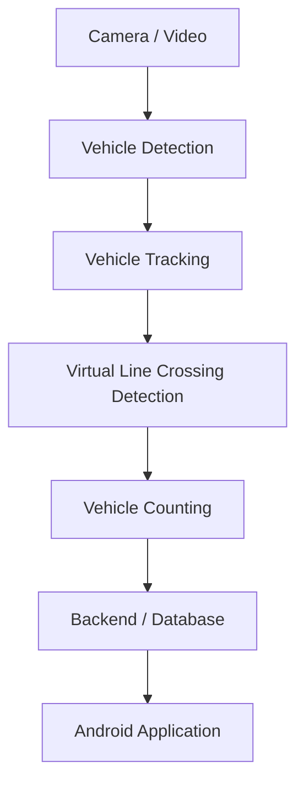

# VisionPark

학교 주차장 한 구역을 대상으로 하는 **카메라 기반 실시간 주차 가능 대수 안내 시스템**입니다. 카메라 영상에서 차량을 탐지·추적하고, 가상 Counting Line을 통과하는 차량을 판별하여 주차 현황을 계산하는 것을 목표로 합니다.

> 로컬 MP4 영상 입력과 YOLO 기반 차량 탐지·시각화를 구현했습니다. Tracking 이후 기능은 아직 구현되지 않았습니다.

## 프로젝트 목표

- 입구와 출구가 분리된 주차장 한 구역을 대상으로 합니다.
- 차량 탐지와 Tracking을 통해 차량의 이동을 파악합니다.
- 화면상의 가상 Counting Line 통과를 판별하여 입차 시 주차 차량 수를 **+1**, 출차 시 **-1** 처리합니다.
- 현재 주차 차량 수와 남은 주차 공간을 계산합니다.
- 최종적으로 Android 애플리케이션에서 실시간 주차 현황을 제공합니다.

예상 계산 방식은 다음과 같습니다.

```text
현재 주차 차량 수 = 초기 주차 차량 수 + 누적 입차 수 - 누적 출차 수
남은 주차 공간 = 전체 주차 면수 - 현재 주차 차량 수
```

초기 주차 차량 수 설정, 전체 주차 면수 설정, 누락·중복 집계 및 오류 보정 정책은 구현 단계에서 결정할 예정입니다.

## 예상 시스템 아키텍처

아래 흐름은 설계 방향입니다. 현재는 로컬 영상 입력·재생과 차량 탐지까지 구현되어 있습니다.



## 예상 기술 스택

| 영역 | 예상 기술 및 방식 | 결정 상태 |
| --- | --- | --- |
| Vision | Python, OpenCV, YOLO 기반 Object Detection | Python/OpenCV, Ultralytics YOLOv8n 차량 탐지 구현 |
| Tracking | Object Tracking | 알고리즘 및 라이브러리 미정 |
| Counting | Virtual Line Crossing 기반 입출차 집계 | 세부 판별 방식 미정 |
| Backend / Database | 주차 현황 저장 및 앱 연동 | 기술 및 통신 방식 미정 |
| Android | Kotlin, Android Studio | 프로젝트 생성 전 |

차량 탐지 기본 모델은 COCO 사전 학습 YOLOv8n이며, Tracking 방식은 향후 검토하여 선택합니다. Backend와 Database는 요구사항에 따라 결정하며, 현재 특정 서비스나 프레임워크를 전제로 하지 않습니다.

## Repository 구조

```text
VisionPark/
├── README.md
├── .gitignore
├── requirements.txt
├── vision/
│   ├── video_input.py
│   └── vehicle_detection.py
├── data/videos/
│   └── .gitkeep
├── tests/
│   ├── test_video_input.py
│   └── test_vehicle_detection.py
├── backend/
│   └── .gitkeep
├── android/
│   └── .gitkeep
└── docs/
    └── .gitkeep
```

| 경로 | 역할 |
| --- | --- |
| `vision/` | 영상 입력·재생 및 차량 탐지·시각화 코드 |
| `data/videos/` | 로컬 테스트 영상 보관 (영상 파일은 Git 제외) |
| `tests/` | 영상 입력, 차량 탐지, FPS 및 종료 처리 자동 검증 |
| `backend/` | 기술 선정 후 주차 현황 저장 및 앱 연동 코드 |
| `android/` | 향후 Kotlin 기반 Android 프로젝트 |
| `docs/` | 요구사항, 설계, 실험 및 검증 기록 |
| `requirements.txt` | 영상 입력과 YOLO 탐지에 필요한 Python dependency 목록 |
| `.gitignore` | 가상환경, 캐시, 로컬 설정 등 Git 제외 규칙 |

각 디렉터리의 `.gitkeep`은 빈 디렉터리를 Git에서 관리하기 위한 placeholder입니다. 로컬 Python 가상환경 `.venv/`는 Git 관리 대상에서 제외합니다.

## 개발 로드맵

- [x] 초기 repository 구조 및 문서 구성
- [ ] 주차장 조건, 카메라 배치 및 집계 요구사항 정리
- [x] 로컬 MP4 영상 입력 및 FPS 기반 재생
- [x] YOLO 기반 차량 탐지 구현 및 자동 테스트
- [ ] 실제 영상에서 차량 탐지 최종 검증
- [ ] Tracking 방식 선정 및 차량 추적 검증
- [ ] 가상 Counting Line 통과와 이동 방향 판별
- [ ] 입출차 집계 및 잔여 주차 공간 계산·검증
- [ ] Backend / Database 기술 선정 및 연동 구현
- [ ] Android 애플리케이션 구현
- [ ] 전체 시스템 통합 및 실제 환경 검증

## 현재 개발 상태

로컬 MP4 영상을 OpenCV 창에 표시하며, 영상 FPS와 프레임 처리 시간을 반영해 원본 속도에 가깝게 재생합니다. FPS가 유효하지 않으면 안내 후 30 FPS를 사용합니다. 영상 창에서 `q`를 누르거나 재생이 끝나면 리소스를 해제하고 창을 닫습니다. 잘못된 입력에는 오류 메시지와 종료 코드 1을 반환합니다.

차량 탐지는 car, motorcycle, bus, truck만 표시하며 Bounding Box와 클래스명·confidence를 출력합니다. Tracking, Line Crossing, Counting, Backend, Database 및 Android 애플리케이션은 미구현 상태입니다. 오디오 재생은 지원하지 않습니다. OpenCV는 재생 중 디코딩 실패와 영상 끝을 동일한 읽기 결과로 반환하므로 두 경우 모두 재생을 종료합니다.

## 기본 실행 방법

프로젝트 루트에서 기존 `.venv`를 사용합니다 (Windows PowerShell, Python 3.12 검증).

```powershell
.\.venv\Scripts\python.exe -m pip install -r requirements.txt
.\.venv\Scripts\python.exe .\vision\video_input.py .\data\videos\sample.mp4
```

직접 준비한 MP4 파일을 `data/videos/`에 넣으세요. 공백이 있는 경로는 따옴표로 감쌉니다. 이 디렉터리의 내용은 `.gitkeep`을 제외하고 Git에서 무시하며, 저장소 내 MP4 파일도 제외합니다. 영상 표시는 GUI를 사용할 수 있는 데스크톱 환경이 필요합니다. 재생 속도는 디코딩 성능과 OS 타이머 정밀도에 따라 달라질 수 있습니다.

자동 검증 (실제 MP4 생성·디코딩, 창과 키 입력은 모의 처리):

```powershell
.\.venv\Scripts\python.exe -m unittest discover -s tests -v
```

## 차량 탐지 실행 (Issue #2)

프로젝트 루트에서 실행합니다. 기본 모델은 `yolov8n.pt`, confidence 기준은 `0.25`이며 CPU에서 실행합니다.

```powershell
.\.venv\Scripts\python.exe -m vision.vehicle_detection .\data\videos\sample.mp4
.\.venv\Scripts\python.exe -m vision.vehicle_detection ".\data\videos\sample.mp4" --model ".\yolov8n.pt" --confidence 0.4
```

`--confidence`는 0보다 크고 1 이하인 유한한 숫자입니다. `--model`에는 네 차량 클래스명을 모두 포함하는 Ultralytics 객체 탐지 모델을 지정합니다. 기본 가중치가 없으면 첫 실행 시 다운로드하므로 인터넷 연결과 저장 공간이 필요합니다. 오프라인에서는 미리 준비한 모델 경로를 지정하세요. 모델은 실행당 한 번 로딩하며, 영상 경로와 첫 프레임을 확인한 뒤 로딩합니다. `.pt` 가중치와 실제 테스트 영상은 Git에서 제외됩니다.

기존 영상 재생 명령은 탐지 없이 그대로 사용할 수 있습니다. 차량 탐지는 기존 재생 루프를 공유하며, 원본 FPS에서 추론·시각화 시간을 뺀 만큼 대기합니다. 추론이 프레임 간격보다 느리면 실제 재생은 느려지며 프레임을 건너뛰지 않습니다. `q`와 창 닫기는 각 프레임 추론 후 처리되므로 추론 중에는 종료 응답이 지연될 수 있습니다. FPS 정보가 없으면 30 FPS를 사용합니다.

없는 경로, MP4가 아닌 파일, 열 수 없거나 첫 프레임을 읽을 수 없는 영상은 오류 메시지와 종료 코드 1을 반환합니다. YOLO 의존성 누락·모델 로딩 실패·추론 리소스 오류·OpenCV 표시 실패도 오류로 종료하고 열린 영상과 창을 정리합니다. 설치 오류는 `pip install -r requirements.txt`의 출력에서 확인하세요. 정상 종료와 `q` 종료는 코드 0입니다.

자동 테스트는 임시 MP4를 생성·디코딩하고 YOLO 결과와 GUI를 모의 처리합니다. 모델 다운로드 없이 차량 필터, Bounding Box·confidence 표시, 모델 로딩·추론 오류, FPS 대기 및 리소스 해제를 검증합니다. 실제 학습 가중치의 탐지 정확도와 실제 창 동작은 직접 준비한 영상으로 최종 확인하세요.

추론 API 참고: [Ultralytics Predict 문서](https://docs.ultralytics.com/modes/predict/).
