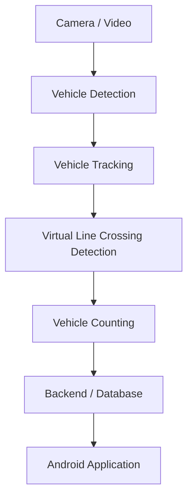

# VisionPark

학교 주차장 한 구역을 대상으로 하는 **카메라 기반 실시간 주차 가능 대수 안내 시스템**입니다. 카메라 영상에서 차량을 탐지·추적하고, 가상 Counting Line을 통과하는 차량을 판별하여 주차 현황을 계산하는 것을 목표로 합니다.

> 현재는 초기 repository 구성 단계입니다. 차량 탐지부터 Android 애플리케이션까지 실제 기능은 아직 구현되지 않았습니다.

## 프로젝트 목표

- 입구와 출구가 분리된 주차장 한 구역을 대상으로 합니다.
- 차량 탐지와 Tracking을 통해 차량의 이동을 파악합니다.
- 화면상의 가상 Counting Line 통과를 판별하여 입차 시 주차 차량 수를 **+1**, 출차 시 **-1** 처리합니다.
- 현재 주차 차량 수와 남은 주차 공간을 계산합니다.
- 최종적으로 Android 애플리케이션에서 실시간 주차 현황을 제공합니다.

예상 계산 방식은 다음과 같습니다.

```text
현재 주차 차량 수 = 초기 주차 차량 수 + 누적 입차 수 - 누적 출차 수
남은 주차 공간 = 전체 주차 면수 - 현재 주차 차량 수
```

초기 주차 차량 수 설정, 전체 주차 면수 설정, 누락·중복 집계 및 오류 보정 정책은 구현 단계에서 결정할 예정입니다.

## 예상 시스템 아키텍처

아래 흐름은 설계 방향이며, 각 구성 요소는 아직 구현되지 않았습니다.



## 예상 기술 스택

| 영역 | 예상 기술 및 방식 | 결정 상태 |
| --- | --- | --- |
| Vision | Python, OpenCV, YOLO 기반 Object Detection | 구체적인 dependency와 버전 미정 |
| Tracking | Object Tracking | 알고리즘 및 라이브러리 미정 |
| Counting | Virtual Line Crossing 기반 입출차 집계 | 세부 판별 방식 미정 |
| Backend / Database | 주차 현황 저장 및 앱 연동 | 기술 및 통신 방식 미정 |
| Android | Kotlin, Android Studio | 프로젝트 생성 전 |

YOLO 모델 버전과 Tracking 방식은 향후 검토하여 선택합니다. Backend와 Database는 요구사항에 따라 결정하며, 현재 특정 서비스나 프레임워크를 전제로 하지 않습니다.

## Repository 구조

```text
VisionPark/
├── README.md
├── .gitignore
├── requirements.txt
├── vision/
│   └── .gitkeep
├── backend/
│   └── .gitkeep
├── android/
│   └── .gitkeep
└── docs/
    └── .gitkeep
```

| 경로 | 역할 |
| --- | --- |
| `vision/` | 향후 차량 탐지, 추적, Line Crossing, Counting 코드 |
| `backend/` | 기술 선정 후 주차 현황 저장 및 앱 연동 코드 |
| `android/` | 향후 Kotlin 기반 Android 프로젝트 |
| `docs/` | 요구사항, 설계, 실험 및 검증 기록 |
| `requirements.txt` | 실제 Vision 구현 시 결정할 Python dependency 목록 |
| `.gitignore` | 가상환경, 캐시, 로컬 설정 등 Git 제외 규칙 |

각 디렉터리의 `.gitkeep`은 빈 디렉터리를 Git에서 관리하기 위한 placeholder입니다. 로컬 Python 가상환경 `.venv/`는 Git 관리 대상에서 제외합니다.

## 개발 로드맵

- [x] 초기 repository 구조 및 문서 구성
- [ ] 주차장 조건, 카메라 배치 및 집계 요구사항 정리
- [ ] 영상 입력과 YOLO 기반 차량 탐지 검증
- [ ] Tracking 방식 선정 및 차량 추적 검증
- [ ] 가상 Counting Line 통과와 이동 방향 판별
- [ ] 입출차 집계 및 잔여 주차 공간 계산·검증
- [ ] Backend / Database 기술 선정 및 연동 구현
- [ ] Android 애플리케이션 구현
- [ ] 전체 시스템 통합 및 실제 환경 검증

## 현재 개발 상태

현재 저장소에는 문서, Git 제외 규칙, dependency 목록 파일과 영역별 빈 디렉터리만 준비되어 있습니다. 차량 탐지, Tracking, Line Crossing, Counting, Backend, Database 및 Android 애플리케이션은 모두 미구현 상태입니다.

`requirements.txt`에는 아직 패키지가 등록되어 있지 않습니다. 구체적인 dependency와 버전은 실제 기능 구현 시 결정하며, 현재 실행 가능한 애플리케이션이나 모델 파일은 제공하지 않습니다.
